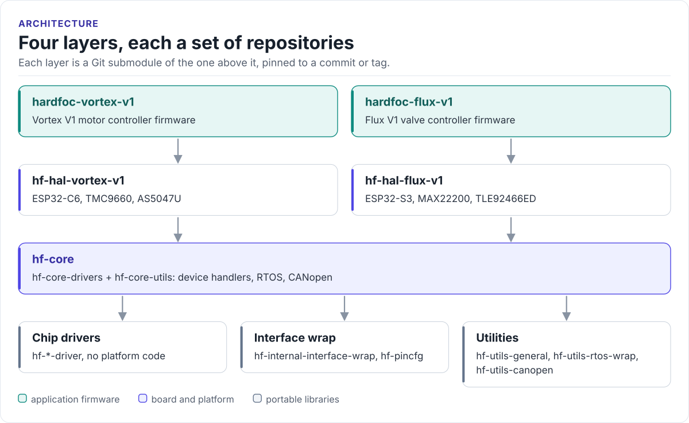

# hardfoc.github.io

The HardFOC portal: what HardFOC is, how its repositories fit together, every public repository with its
documentation, and where to start with each board.

[](https://hardfoc.github.io/)
[](LICENSE)

**Site: <https://hardfoc.github.io/>**

<!-- figure: hardfoc-layers -->
<picture>
  <source media="(prefers-color-scheme: dark)" srcset="docs/diagrams/hardfoc-layers.dark.svg">
  
</picture>
<!-- /figure -->

## What it does

- Introduces HardFOC and its two boards, Vortex V1 and Flux V1.
- Shows the four layers (chip drivers, core, board HALs, products) and how they are pinned together.
- Lists every public repository as a card with its description, topics, documentation and latest release,
  generated from the GitHub API and [`org/org-metadata.json`](https://github.com/hardfoc/.github/blob/main/org/org-metadata.json)
  at every publish, and filterable by text or topic.
- Gives a getting-started path per board, and for a chip driver on any MCU.
- Links the contribution rules and the private vulnerability report.

## Build locally

```bash
pip install "git+https://github.com/hardfoc/hf-general-ci-tools@v1#subdirectory=packages/hardfoc-mkdocs-theme"
GH_TOKEN=$(gh auth token) python3 tools/portal/catalogue.py   # writes build/portal/catalogue.md
mkdocs serve                                                  # http://127.0.0.1:8000
```

The site is unversioned: `.github/workflows/docs.yml` calls `ru-mkdocs-publish.yml` from
[hf-general-ci-tools](https://hardfoc.github.io/hf-general-ci-tools/latest/) with `versioning: false`, and a push
to `main` (or the daily run) publishes the built site as the whole `gh-pages` branch.

## Documentation

| Page | What it covers |
| --- | --- |
| [Get started](https://hardfoc.github.io/get-started/) | A path per board, and for a chip driver on your MCU |
| [Repositories](https://hardfoc.github.io/repositories/) | Every public repository, searchable |
| [Architecture](https://hardfoc.github.io/architecture/) | The layers and how they are pinned |
| [Contribute](https://hardfoc.github.io/contribute/) | Issues, pull requests, vulnerability reports |

## Tests

```bash
python3 -m unittest discover -s tests && mkdocs build --strict
```

## License

See [LICENSE](LICENSE).
