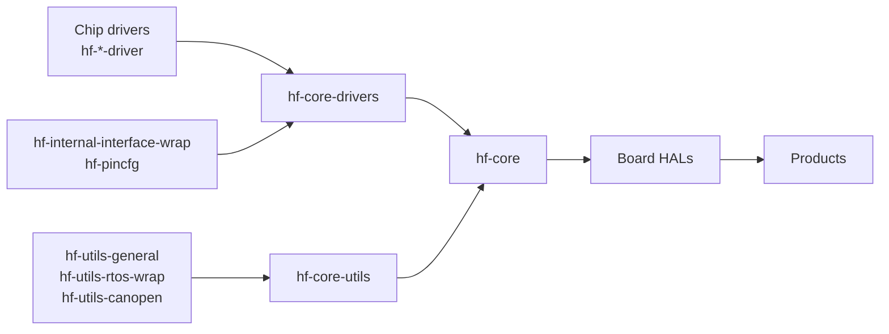

# Architecture

How HardFOC firmware is split into repositories, and how the layers are pinned together.

<!-- figure: hardfoc-layers -->
<picture>
  <source media="(prefers-color-scheme: dark)" srcset="diagrams/hardfoc-layers.dark.svg">
  
</picture>
<!-- /figure -->

## Layers

| Layer | Repositories | Depends on | Contains |
| --- | --- | --- | --- |
| Products | `hardfoc-vortex-v1`, `hardfoc-flux-v1` | One board HAL | The application: tasks, protocols (CANopen on Vortex), faults; ESP-IDF only in its start-up code |
| Board HALs | `hf-hal-vortex-v1`, `hf-hal-flux-v1` | `hf-core` | One facade per board, one manager per board function, and the platform bind: the only code that names the MCU |
| Core | `hf-core`, gathering `hf-core-drivers` and `hf-core-utils` | Drivers, interface wrap, utilities | One handler per chip (locking, start-up, error mapping), the logger, CANopen integration |
| Interface wrap | `hf-internal-interface-wrap`, `hf-pincfg` | The MCU vendor SDK, only inside each family's implementation | Platform-free peripheral base classes (GPIO, ADC, I2C, SPI, UART, CAN, PWM, NVS, timers, temperature, logging) with implementations for ESP32 (ESP-IDF), STM32 (STM32 HAL) and the host; header-only per-board pin maps |
| Utilities | `hf-utils-general`, `hf-utils-canopen`, `hf-utils-rtos-wrap` | None; rtos-wrap uses the selected RTOS | General helpers and CANopen frame builders, platform-free, in headers and sources; RTOS wrappers with FreeRTOS, CMSIS-RTOS2, ThreadX and no-RTOS backends |
| Chip drivers | `hf-*-driver` | Nothing | Platform-free C++20 templates over a small communication interface you implement; MCU-bound drivers such as `hf-ws2812-rmt-driver` say so |

The [repository catalogue](repositories.md) lists every repository in each layer, with its documentation.

## The stack contract

What each layer promises, what it may include, and the rules for errors, threads, time and naming are in the
[HardFOC engineering standard](https://github.com/hardfoc/.github/blob/main/standards/README.md):

| Topic | Page |
| --- | --- |
| The layers and their allowed includes | [Layers](https://github.com/hardfoc/.github/blob/main/standards/layers.md) |
| One error model across the stack | [Errors](https://github.com/hardfoc/.github/blob/main/standards/errors.md) |
| Locks, clocks, delays and the 1 kHz tick | [Threading and timing](https://github.com/hardfoc/.github/blob/main/standards/threading-and-timing.md) |
| Contracts per layer | [Driver](https://github.com/hardfoc/.github/blob/main/standards/driver.md), [library](https://github.com/hardfoc/.github/blob/main/standards/library.md), [handler](https://github.com/hardfoc/.github/blob/main/standards/handler.md), [board HAL](https://github.com/hardfoc/.github/blob/main/standards/hal.md), [product](https://github.com/hardfoc/.github/blob/main/standards/product.md) |
| Why it is this way | [Architecture decision records](https://github.com/hardfoc/.github/blob/main/standards/adr/README.md) |

## Submodules, not packages

Each arrow in the figure is a Git submodule pinned to a commit or tag:

A product therefore builds exactly the commits it pins, all the way down. Moving a layer forward is a pull request
that updates one submodule pointer and passes that repository's CI.

## Shared tooling

| Repository | Provides |
| --- | --- |
| [`hf-general-ci-tools`](https://hardfoc.github.io/hf-general-ci-tools/latest/) | Reusable workflows (lint, analysis, host builds, the CI gate, releases) and the documentation platform this site is built with |
| [`hf-espidf-ci-tools`](https://github.com/hardfoc/hf-espidf-ci-tools) | ESP-IDF builds of examples and firmware, releases with artifacts |
| [`hf-espidf-project-tools`](https://github.com/hardfoc/hf-espidf-project-tools) | Build and flash scripts for ESP-IDF example projects |

Next: [Get started](get-started/index.md).
