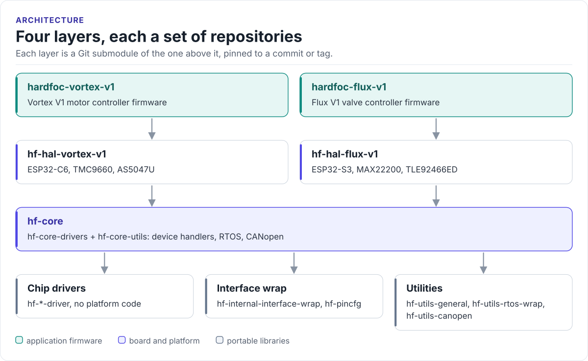
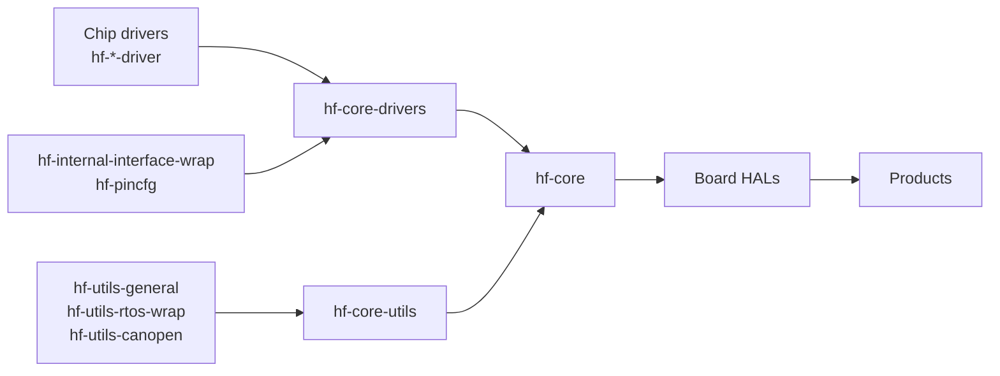

# Architecture

How HardFOC firmware is split into repositories, and how the layers are pinned together.

<!-- figure: hardfoc-layers -->
<picture>
  <source media="(prefers-color-scheme: dark)" srcset="diagrams/hardfoc-layers.dark.svg">
  
</picture>
<!-- /figure -->

## Layers

| Layer | Repositories | Depends on | Platform code |
| --- | --- | --- | --- |
| Products | `hardfoc-vortex-v1`, `hardfoc-flux-v1` | One board HAL | ESP-IDF application, tasks, CANopen (Vortex) |
| Board HALs | `hf-hal-vortex-v1`, `hf-hal-flux-v1` | `hf-core` | One object per board, one manager per board function |
| Core | `hf-core`, gathering `hf-core-drivers` and `hf-core-utils` | Drivers, interface wrap, utilities | Device handlers, RTOS wrappers, CANopen helpers |
| Interface wrap | `hf-internal-interface-wrap`, `hf-pincfg` | ESP-IDF | Peripheral base classes (GPIO, ADC, I2C, SPI, UART, CAN, PWM) and their ESP-IDF implementations; per-board pin maps |
| Utilities | `hf-utils-general`, `hf-utils-rtos-wrap`, `hf-utils-canopen` | None, or FreeRTOS | Header-only helpers, FreeRTOS wrappers, CANopen frame builders |
| Chip drivers | `hf-*-driver` | Nothing | None: each driver is a template over a small communication interface |

The [repository catalogue](repositories.md) lists every repository in each layer, with its documentation.

## Submodules, not packages

Each arrow in the figure is a Git submodule pinned to a commit or tag:

A product therefore builds exactly the commits it pins, all the way down. Moving a layer forward is a pull request
that updates one submodule pointer and passes that repository's CI.

## Shared tooling

| Repository | Provides |
| --- | --- |
| [`hf-general-ci-tools`](https://hardfoc.github.io/hf-general-ci-tools/latest/) | Reusable workflows (lint, analysis, host builds, the CI gate, releases) and the documentation platform this site is built with |
| [`hf-espidf-ci-tools`](https://github.com/hardfoc/hf-espidf-ci-tools) | ESP-IDF builds of examples and firmware, releases with artifacts |
| [`hf-espidf-project-tools`](https://github.com/hardfoc/hf-espidf-project-tools) | Build and flash scripts for ESP-IDF example projects |

Next: [Get started](get-started/index.md).
