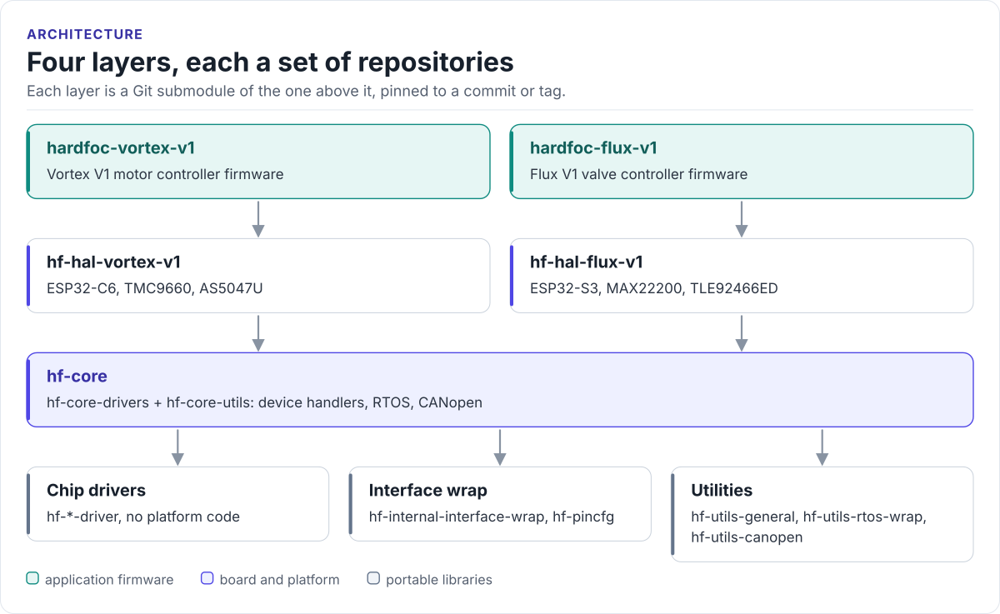

# Figures

<!-- Generated by hardfoc-docs figures from docs/diagrams/figures/*.py. Do not edit by hand. -->

Every figure on this site is drawn by a Python module from facts extracted from the code, so it is rebuilt,
not redrawn, when the code changes. CI runs `hardfoc-docs figures --check` and fails when a
committed figure no longer matches the code. Each figure below lists the files it is drawn from.

## Four layers, each a set of repositories

<!-- figure: hardfoc-layers -->
<picture>
  <source media="(prefers-color-scheme: dark)" srcset="hardfoc-layers.dark.svg">
  
</picture>
<!-- /figure -->

Figure module: [`docs/diagrams/figures/hardfoc-layers.py`](../../docs/diagrams/figures/hardfoc-layers.py)

Drawn from:

- [`mkdocs.yml`](../../mkdocs.yml)
