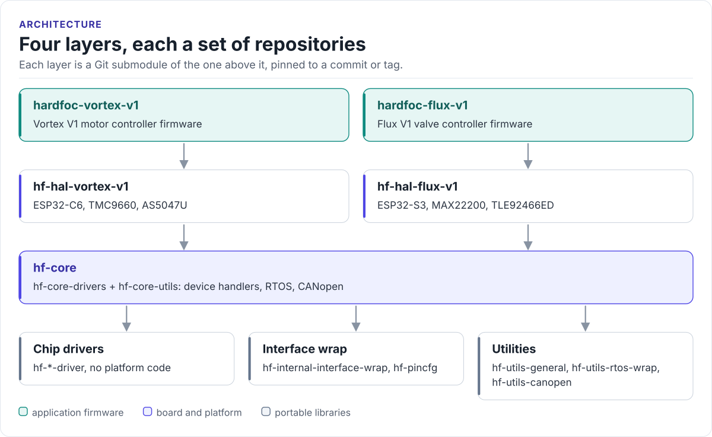

---
hide:
  - navigation
  - toc
---

Hardware-based field-oriented control

# HardFOC

Open firmware for ESP32 motor and valve controller boards. Motor commutation runs on dedicated FOC driver chips,
such as the TMC9660, instead of in MCU software; the firmware around them is C++ on ESP-IDF and FreeRTOS, split
into portable chip drivers, a shared core, board HALs and one application per board.

[Get started](get-started/index.md){ .md-button .md-button--primary }
[All repositories](repositories.md){ .md-button }
[HardFOC on GitHub](https://github.com/hardfoc){ .md-button }

## Start with a board, or a chip

-   **[Vortex V1 motor controller](get-started/vortex.md)**

    ESP32-C6 with a TMC9660 smart gate driver running FOC on chip, an AS5047U magnetic encoder and CAN
    (CANopen).

-   **[Flux V1 valve controller](get-started/flux.md)**

    ESP32-S3 with on/off and proportional solenoid channels on a TLE92466ED and a MAX22200.

-   **[A chip driver on your own MCU](get-started/drivers.md)**

    Every `hf-*-driver` is hardware-agnostic C++: no platform code, one small bus adapter, ESP32 examples.

## How the code is layered

<!-- figure: hardfoc-layers -->
<picture>
  <source media="(prefers-color-scheme: dark)" srcset="diagrams/hardfoc-layers.dark.svg">
  
</picture>
<!-- /figure -->

Each box is one or more repositories; each arrow is a Git submodule pinned to a commit or tag. The
[architecture page](architecture.md) shows the repositories in each layer.

## Documentation

Every repository with a documentation site publishes it at `https://hardfoc.github.io/<repository>/`, versioned:
`latest/` is the newest release (or the default branch until the first release), and older versions stay
available. The [repository catalogue](repositories.md) links each one, with its topics and latest release.

-   **[Repositories](repositories.md)**

    Every public repository, searchable by name, description and topic.

-   **[Architecture](architecture.md)**

    Drivers, core, HALs and products, and how they are pinned together.

-   **[Contribute](contribute.md)**

    How to report a problem, propose a change, and report a vulnerability privately.

